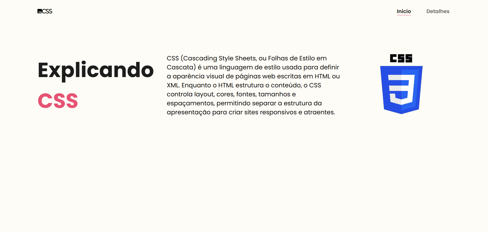
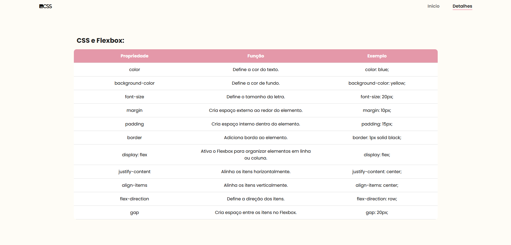

# 🎨 Explicando CSS

Projeto da faculdade para praticar HTML e CSS: duas páginas que explicam o que é CSS e reúnem as propriedades mais usadas, com foco em Flexbox.


---

## 📖 Sobre o projeto

Este projeto foi desenvolvido como atividade da faculdade, com o objetivo de colocar em prática o que aprendi de **CSS**: estilização de texto, cores, espaçamentos, layout com **Flexbox** e estilização de tabelas.

O site tem duas páginas:

- **Início** – uma breve explicação do que é CSS, com a logo da tecnologia.
- **Detalhes** – uma tabela com as principais propriedades de CSS e Flexbox, a função de cada uma e um exemplo de uso.

## 🖼️ Preview

### Página inicial


### Página de detalhes


## ✨ O que foi praticado

- Estrutura semântica com `header`, `nav`, `main` e `section`
- Layout com **Flexbox** (`display: flex`, `justify-content`, `align-items`, `flex-direction`, `gap`)
- Reset básico de estilos e `box-sizing: border-box`
- Estilização de tabelas (`border-collapse`, `border-radius`, `:hover` nas linhas)
- Navbar com indicador de página ativa
- Fonte personalizada com **Google Fonts** (Poppins)
- Ícones com **Font Awesome**
- Organização do projeto em pastas (`css/`, `img/`)

## 🛠️ Tecnologias

- HTML5
- CSS3
- [Google Fonts – Poppins](https://fonts.google.com/specimen/Poppins)
- [Font Awesome](https://fontawesome.com/)

## 📁 Estrutura de pastas

```
explicando-css/
├── css/
│   └── styles.css
│   
├── img/
│   ├── css-logo.png
│   ├── preview-detalhes.png
│   └── preview-inicio.png
│
├── index.html        # Página inicial
├── index2.html       # Página de detalhes (tabela de propriedades)
└── README.md
```

## 🚀 Como executar

Não precisa instalar nada. É só abrir no navegador:

1. Clone o repositório:
   ```bash
   git clone https://github.com/SEU-USUARIO/explicando-css.git
   ```
2. Entre na pasta:
   ```bash
   cd explicando-css
   ```
3. Abra o arquivo `index.html` no navegador (clique duas vezes nele ou use a extensão *Live Server* do VS Code).

> **Obs.:** a fonte e os ícones são carregados pela internet (Google Fonts e Font Awesome), então é preciso estar conectado para ver tudo como no preview.

## 👩‍💻 Autor

Feito por **Beatriz Yumi M. Hara** como parte da graduação em **Engenharia de Sofware**.

[](https://github.com/yumihhara)
[](https://linkedin.com/in/yumi-hara)
